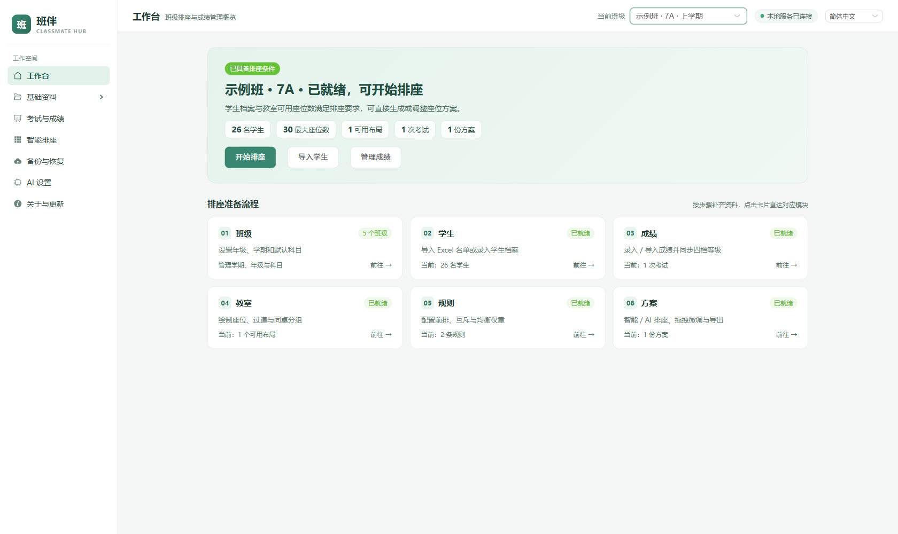
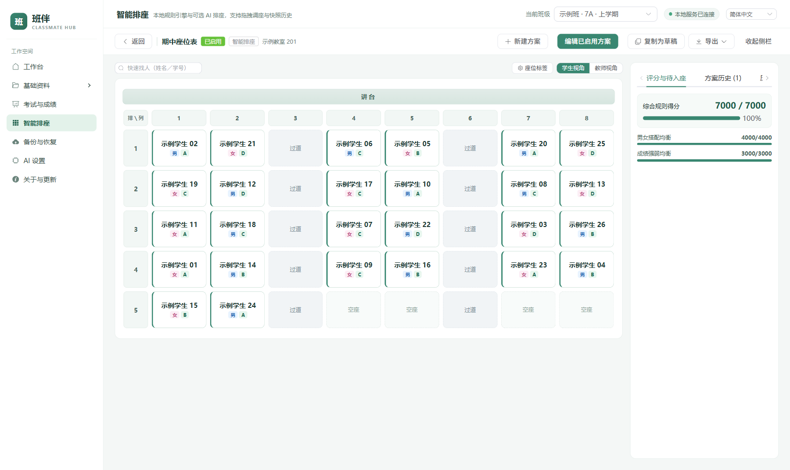
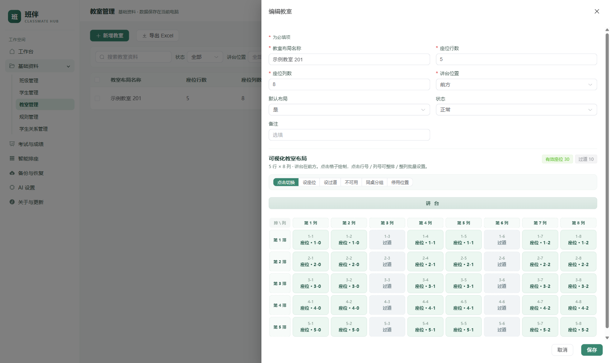
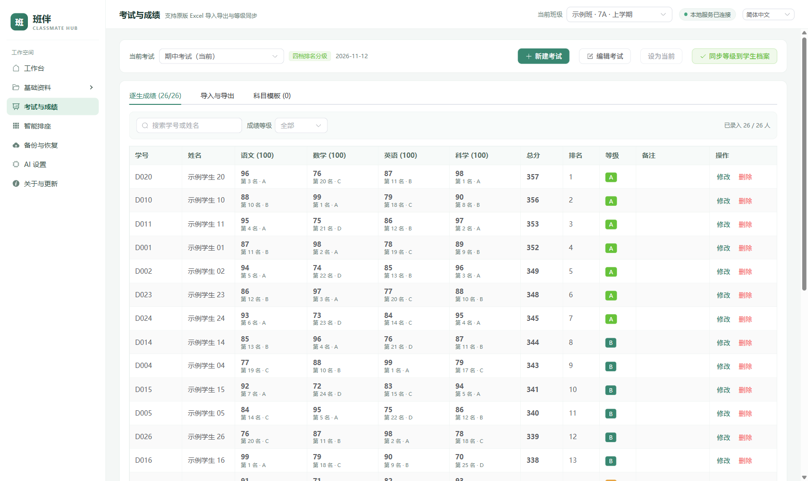
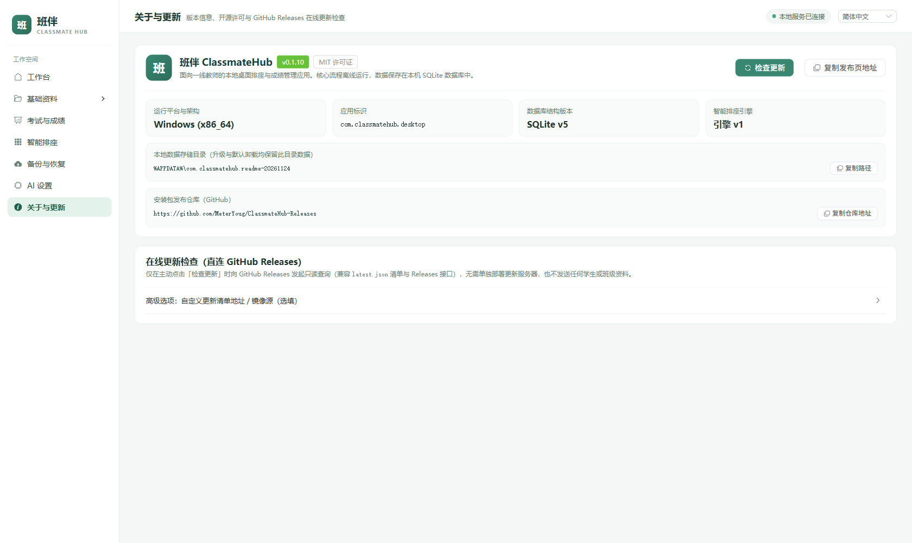

<div align="center">

# 班伴 ClassmateHub

**面向一线教师的本地桌面排座与成绩管理应用**

无需部署服务端 · 无需注册登录 · 核心流程完全离线 · 支持 Windows / macOS / Linux

[](https://github.com/MeterYoug/ClassmateHub-Releases/releases/latest)
[](docs/project-overview.md)
[](#核心能力)
[](LICENSE)

**简体中文** · [English](docs/readme/README.en.md) · [繁體中文](docs/readme/README.zh-Hant.md) · [日本語](docs/readme/README.ja.md) · [한국어](docs/readme/README.ko.md)

[下载安装包](#下载与平台支持) · [界面预览](#界面预览) · [核心能力](#核心能力) · [使用说明](#使用与升级说明) · [本地开发](#本地开发)

</div>

---

**班伴（ClassmateHub-Rust）** 以原排座项目的教师业务流程为参考，面向单机桌面场景从零独立重构。教师在一台电脑上即可完成班级与学生管理、考试成绩导入与分档、教室可视化绘制、规则自动排座、拖拽微调、座位表导出及整库备份恢复；除可选的联网 AI 排座与手动检查更新外，全部核心功能均可在断网环境下使用。

## 下载与平台支持

前往最新公开测试版发布页获取安装包、更新清单与校验文件。 [下载最新公开测试版](https://github.com/MeterYoug/ClassmateHub-Releases/releases/latest)

| 目标平台 | 安装格式 | 构建与验证状态 | 说明 |
| --- | --- | --- | --- |
| **Windows 11 x64** | NSIS 安装版 `.exe`、解压版 `.zip` | 已通过自动化测试、打包和 ZIP 解压验证 | 安装版内置 WebView2 离线安装程序并支持覆盖升级。解压版使用系统已有的 WebView2 Runtime |
| **macOS（Apple Silicon）** | `.dmg`（macOS 15.0 起） | GitHub Actions 自动化测试与打包通过 | **尚未进行实机安装、运行及升级测试** |
| **Ubuntu 24.04 LTS x64** | `.deb`（`classmatehub`） | GitHub Actions 自动化测试与打包通过 | **尚未进行实机安装、运行及升级测试** |

> [!NOTE]
> **测试状态说明**：macOS 和 Linux 尚未进行实机安装、运行及升级测试，目前仅通过了两个平台的 GitHub Actions 自动化测试与打包验证。Windows 11 x64 升级前请先关闭正在运行的班伴，再运行新版安装包覆盖升级（用户数据独立保存，升级与默认卸载均保留本地数据）。

## 界面预览

> 以下截图来自当前开发预览版，使用合成示例数据。

### 1. 工作台概览
集中展示当前班级的排座就绪状态、关键数据指标与 6 步准备流程，点击卡片即可直达对应模块。



### 2. 智能排座与实时规则评分
独立 Rust 规则引擎离线生成方案，多余空位默认优先留至远离讲台的右下角；支持方案列表管理、座位微标切换、拖拽换座、撤销重做、批量锁座、历史对比与多格式导出，右侧实时呈现各项软规则得分。



### 3. 教室可视化布局编辑
支持四向讲台设置、点击格子绘制座位／过道／不可用位置与同桌分组，点击行号或列号可整排／整列批量设置，并实时统计有效座位数。



### 4. 考试与成绩管理
支持班级科目自动带入、科目模板维护、原版 `.xlsx` 预检导入与单人连续录分，自动计算单科与总分排名及 A / B / C / D 四档等级，可一键同步至学生档案供排座均衡规则使用。



### 5. 关于与在线检查更新
查看当前版本、运行平台、SQLite 与排座引擎版本及本地数据存储路径；手动点击「检查更新」即可直连 GitHub Releases 检查与下载新版本，支持自定义 HTTPS 更新源，不发送任何学生或业务数据。



## 核心能力

| 模块 | 核心功能亮点 |
| --- | --- |
| **工作台与全局导航** | 顶部栏跨页共享「当前班级」选择器；展示建班、名单、成绩、布局、规则、方案的就绪进度与快捷入口。 |
| **基础资料与新学期复制** | 覆盖小学一年级至高中三年级及默认科目联动；支持筛选、抽屉表单校验、批量停用与 Excel 导出；新学期复制自动推算目标学年／学期，并按需复制学生、关系、规则与默认教室布局。 |
| **考试与成绩管理** | 支持 `.xlsx` 模板下载、导入前全量预检（有错整批不写入）、分科留空保留原值及「缺考／清空」状态；新考试按总排名划分 A / B / C / D 四档并可同步至学生档案，兼容旧考试得分率口径。 |
| **教室布局与排座规则** | 四向讲台、可视化网格画笔、整排／整列批量绘制与「座位明细（高级）」管理；支持多人前排、不能同桌、不能相邻、优先同桌及视力／身高／性别／成绩／纪律等软硬规则配置。 |
| **智能排座与多格式导出** | 固定种子可复现排座、空位默认留至右下角、空白手动创建、拖拽移座／换座、撤销重做、批量锁座、方案列表与同班旧方案归档、历史变动对比；支持学生版／教师版 PNG、Excel 与横向 A4 PDF 导出。 |
| **整库备份与中断回退** | 基于 SQLite Online Backup API 导出一致性 `.classmatehub-backup` 备份；覆盖恢复前先只读预检并自动留存恢复点，提交校验失败或恢复中断时自动回退。 |
| **可选 AI 排座（隐私脱敏）** | 支持多供应商预设、模型发现、连接测试与默认模型；仅在逐次确认服务地址、模型与发送载荷后发起请求，仅发送一次性临时编号、座位坐标与硬约束，姓名、学号与成绩始终留在本机。 |
| **关于与在线更新** | 仅在用户主动点击时向 `ClassmateHub-Releases` 发起只读查询（兼容 `latest.json` 与 Releases 接口），支持自定义 HTTPS 清单地址与应用内另存为下载安装包。 |

## 使用与升级说明

<details>
<summary><strong>基础资料、Excel 导入与成绩口径要点</strong></summary>

- **学生导入**：在「学生管理 → 导入学生」下载模板，可填写学号、姓名、性别、身高、视力、纪律、成绩等级、特殊需求、排序号与备注；勾选「按学号更新该班已有学生」时，留空的可选列沿用原值。
- **成绩导入与分档**：导入使用 `.xlsx` 文件，学号请保留文本格式，总分与排名由应用重算；留空保留原分，填写「缺考」或「清空」可修改状态。新考试按班级总排名平均分为 A / B / C / D 四档，升级前旧考试默认沿用原有得分率口径，可在编辑考试时主动切换。
- **成绩排名与科目表头**。使用排名分档时，至少一门计入总分的科目有数值才参与总排名，实际录入的 0 分有效。若科目与「等级」「总分」等表头同名，请下载该场考试的模板，在模板标出的科目列录分。
- **规则与安全保护**：缩小教室前需先在「座位明细」停用超出新范围的位置；既有自定义／异常规则可在保留原配置下停用。切换页面、班级或关闭窗口时均有未保存提醒，保存已有记录时执行并发变更检测。

</details>

<details>
<summary><strong>排座、导出、备份恢复与 AI 隐私边界</strong></summary>

- **排座与快照**：新方案默认按同排相邻座位自动配对（自定义同桌分组优先）；方案保存后锁定当时的名单、布局与规则快照，后续修改基础资料不会导致历史方案漂移。
- **座位表视角与导出**。切换到教师视角时，讲台与座位图一起旋转 180°，座号仍按教室布局显示。PNG、Excel 和 PDF 沿用所选视角。PNG 与 PDF 使用适合黑白打印的白底黑框表格，排号显示在左侧，列号显示在顶部，姓名居中，省略规则评分。PDF 将完整座位表缩放到单页横向 A4。Excel 教师版保留学号、锁座标记与规则评分工作表。
- **备份与恢复**：备份文件包含学生、成绩与历史方案，请妥善保管；系统凭据与日志不进入备份。跨设备恢复后需重新配置 AI 接入点与凭据。
- **AI 排座与回退**：Windows 密钥保存在系统凭据存储中，连接测试仅发送固定文本。AI 方案须通过本地硬约束校验后方可保存；失败时默认等待教师选择「改用本地智能排座」，回退沿用同一份快照、锁座与种子。

</details>

<details>
<summary><strong>Windows 覆盖升级与 0.1.8 更新检查说明</strong></summary>

- **Windows 覆盖升级**：同一 Windows 账户下升级时，先关闭正在运行的班伴，再运行新版 NSIS 安装包；向导会默认选中「覆盖升级（保留本地数据）」并沿用原安装目录。
- **在线检查更新**：自 `0.1.9` 起，点击「关于与更新 → 检查更新」默认直连 `ClassmateHub-Releases` 的 GitHub Releases。
- **`0.1.8` 用户迁移提示**：已安装 `0.1.8` 的用户可在「关于与更新 → 高级选项」填入以下地址后检查更新：
  ```text
  https://github.com/MeterYoug/ClassmateHub-Releases/releases/latest/download/latest.json
  ```

</details>

## 本地开发

环境要求：Node.js、npm、Rust 工具链（Windows 另需 Visual Studio C++ 构建工具及 WebView2 Runtime；各目标平台打包依赖见 [项目总览](docs/project-overview.md) ）。

```powershell
# 安装前端依赖
npm ci

# 启动桌面端开发模式（首次启动会编译 Rust 依赖）
npm run tauri dev

# 仅构建前端静态资源（浏览器中无桌面命令，本地服务状态将显示未连接）
npm run build
```

## 项目文档与许可

| 文档 | 说明 |
| --- | --- |
| [项目总览与技术设计](docs/project-overview.md) | 产品定位、数据表设计、排座引擎、备份恢复与三端构建说明 |
| [许可证（MIT）](LICENSE) | 本项目代码采用 MIT 开源许可证 |
