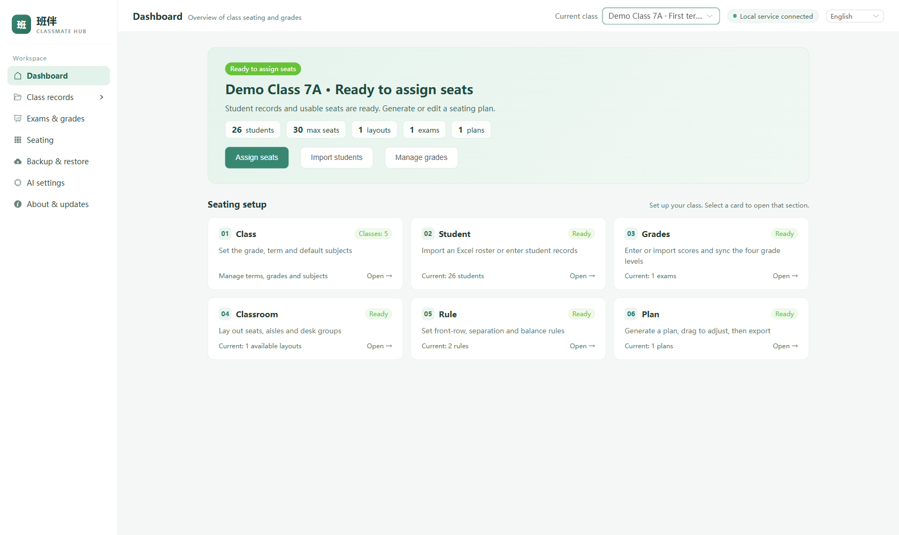
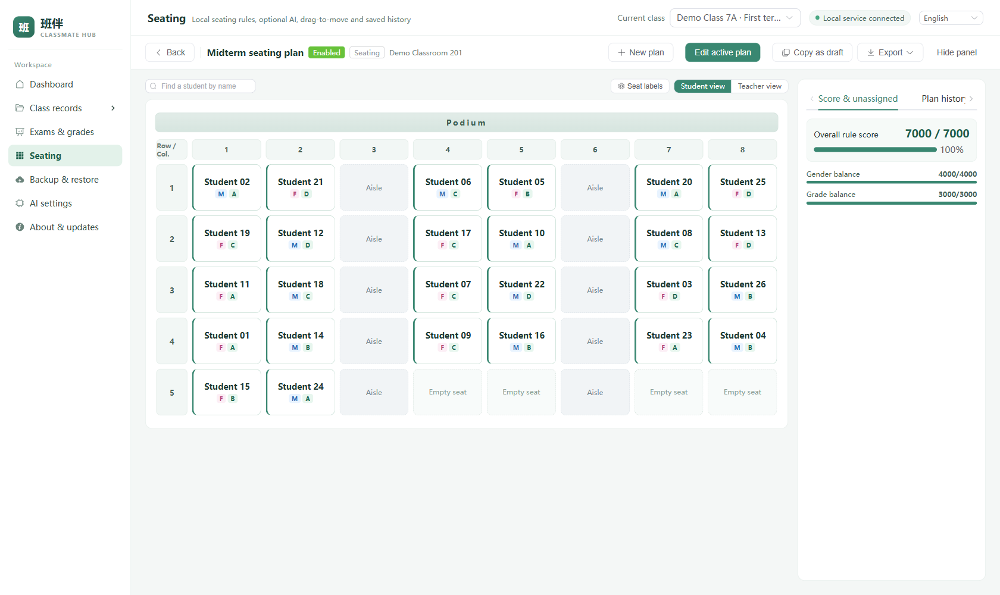
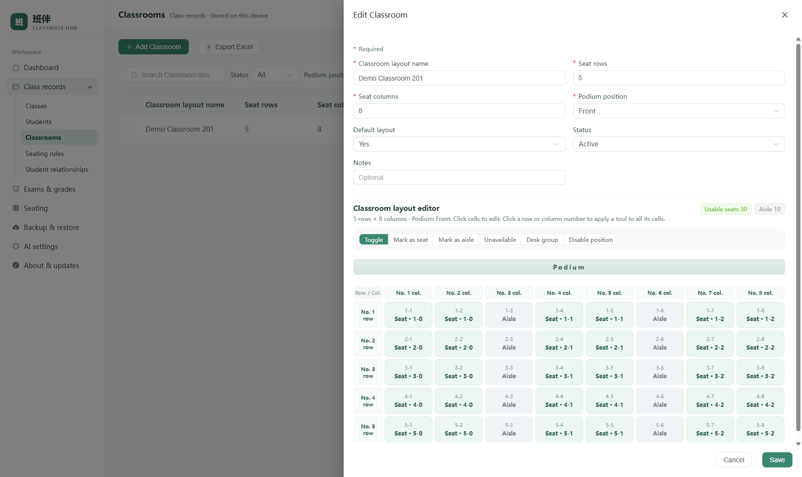
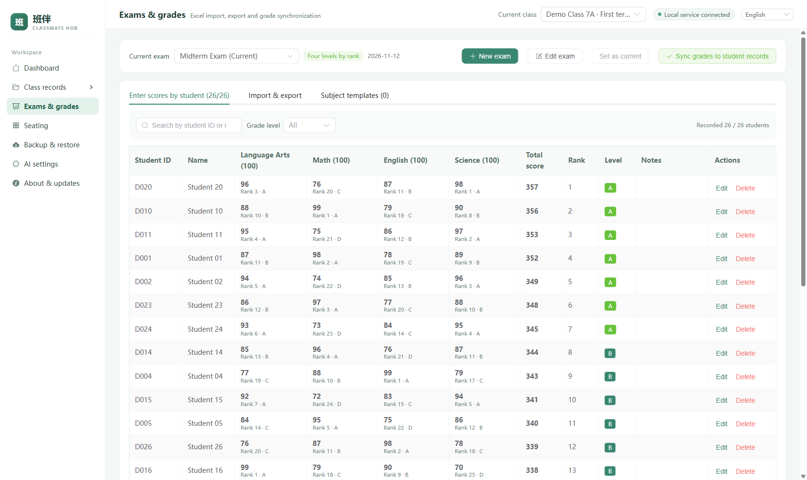
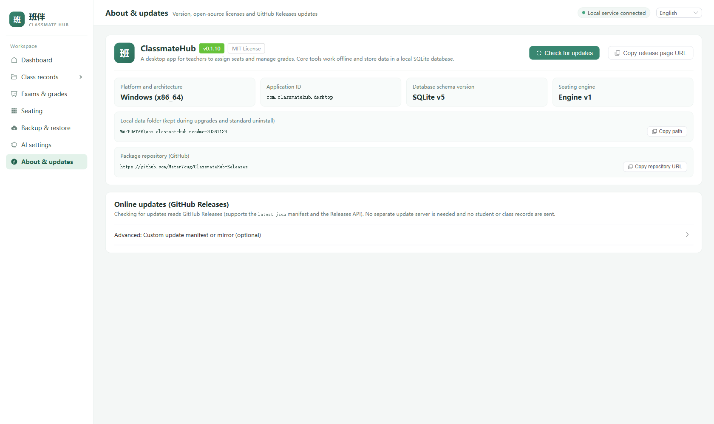

<div align="center">

# ClassmateHub 班伴

**An offline desktop app for teachers to arrange classroom seating and manage grades**

No server setup · No account required · Core features work offline · Windows / macOS / Linux

[](https://github.com/MeterYoug/ClassmateHub-Releases/releases/latest)
[](../project-overview.md)
[](#features)
[](../../LICENSE)

[简体中文](../../README.md) · **English** · [繁體中文](README.zh-Hant.md) · [日本語](README.ja.md) · [한국어](README.ko.md)

[Downloads](#downloads-and-platform-support) · [Screenshots](#screenshots) · [Features](#features) · [Usage and upgrades](#usage-and-upgrades) · [Local development](#local-development)

</div>

---

ClassmateHub is a standalone desktop rewrite based on the workflows of the original classroom seating project. Teachers can manage classes and students, import and group exam grades, draw classroom layouts, generate and fine-tune seating plans, export seating charts, and back up or restore the entire database on one computer. Internet access is only needed for optional AI seating and manual update checks.

## Downloads and platform support

Get installers, the update manifest, and checksum files from the [latest public beta release](https://github.com/MeterYoug/ClassmateHub-Releases/releases/latest).

| Platform | Package format | Build and test status | Notes |
| --- | --- | --- | --- |
| **Windows 10/11 x64** | NSIS installer `.exe`, portable `.zip` | Automated tests, packaging, and ZIP extraction verified. Testing on a Windows 10 machine is pending. | The installer bundles the offline WebView2 installer and supports in-place upgrades. The portable version uses the system's existing WebView2 Runtime. |
| **macOS (Apple Silicon)** | `.dmg` (macOS 15.0 or later) | Automated tests and packaging passed on GitHub Actions | **Installation, runtime, and upgrades have yet to be tested on a physical machine.** |
| **Ubuntu 24.04 LTS x64** | `.deb` (`classmatehub`) | Automated tests and packaging passed on GitHub Actions | **Installation, runtime, and upgrades have yet to be tested on a physical machine.** |

> [!NOTE]
> On macOS and Linux, verification so far covers automated tests and packaging on GitHub Actions. On Windows 10/11 x64, close ClassmateHub before running a new installer for an in-place upgrade. Local data is stored separately and is kept during in-place upgrades and standard uninstallation.

## Screenshots

> Screenshots show the current development preview with synthetic sample data.

### 1. Dashboard

Check the current class's seating readiness, key counts, and six preparation steps. Click a card to open the relevant module.



### 2. Smart seating and live rule scoring

The standalone Rust rules engine generates plans offline and prioritizes empty seats at the bottom right, away from the podium. Manage plans, toggle seat labels, swap seats by dragging, undo and redo, lock seats in bulk, compare past plans, and export in several formats. The sidebar shows live scores for individual soft rules.



### 3. Visual classroom layout editor

Set the podium on any of the four sides, draw seats, aisles, and unavailable positions, and define desk-mate groups. Click a row or column number to edit it in bulk. The editor shows a running count of usable seats.



### 4. Exams and grades

Use default subjects for each class, maintain subject templates, run validation before importing `.xlsx` workbooks, and enter grades one student at a time. ClassmateHub calculates subject and overall rankings and assigns A through D grade bands. Sync those bands to student records for use in seating rules.



### 5. About and online updates

View the current app version, runtime platform, SQLite and seating engine versions, and the location of local data. Manually check GitHub Releases for updates and download new packages. Custom HTTPS update sources are supported. Update checks send no student or school data.



## Features

| Module | Capabilities |
| --- | --- |
| **Dashboard and navigation** | Switch the current class from the shared top bar. Track setup progress and jump to classes, rosters, grades, layouts, rules, and plans. |
| **Class data and new-term copying** | Manage grades from the first year of primary school through the final year of high school, with linked default subjects. Filter records, validate forms, deactivate records in bulk, and export to Excel. The new-term workflow determines the target school year and term and lets you copy students, relationships, rules, and the default classroom layout. |
| **Exams and grades** | Download `.xlsx` templates and validate the whole import before saving any rows. Leave subject scores blank to keep existing values, or use `缺考` for absent and `清空` to clear a grade. New exams assign A–D bands by overall class rank and can sync them to student records. Older exams can still use percentage scores. |
| **Classroom layout and rules** | Place the podium on any side, draw on a grid, edit complete rows or columns, and manage individual seats in the advanced seat editor. Set front-row requirements, forbid sharing a desk or sitting next to certain students, or prefer desk mates. Set hard and soft rules for eyesight, height, gender, grades, and behavior. |
| **Smart seating and exports** | Generate repeatable plans with a fixed seed, place empty seats at the bottom right by default, or create a blank plan manually. Move and swap seats by dragging, undo and redo, lock seats in bulk, manage plans, archive older plans for the same class, and compare changes. Export student or teacher versions as PNG, Excel, or landscape A4 PDF. |
| **Full database backups and rollback** | Export consistent `.classmatehub-backup` files with the SQLite Online Backup API. An overwrite restore performs a read-only preflight check and creates a restore point. It rolls back automatically if validation fails or restoration is interrupted. |
| **Optional AI seating with de-identified data** | Choose from provider presets, discover models, test connections, and set a default model. Each request requires confirmation of the service URL, model, and payload. It uses one-time IDs, seat coordinates, and hard constraints. Student names, IDs, and grades stay on the device. |
| **About and updates** | When prompted by the user, make a read-only query to `ClassmateHub-Releases` using `latest.json` or the Releases API. Set a custom HTTPS manifest URL and save the installer from inside the app. |

## Usage and upgrades

<details>
<summary><strong>Class data, Excel imports, and grading rules</strong></summary>

- **Student import.** Download the template from Student Management → Import Students. Columns include student ID, name, gender, height, eyesight, behavior, grade band, special needs, sort order, and notes. When updating existing students in the current class by ID, blank optional cells keep their existing values.
- **Grade import and bands.** Use an `.xlsx` file and keep student IDs formatted as text. The app recalculates totals and ranks. Blank cells keep existing scores. Enter `缺考` to mark a student absent or `清空` to clear a score. New exams divide the class into four bands, A through D, by overall rank. Older exams keep their percentage-based method by default and can be switched when editing the exam.
- **Ranking and subject headers.** With rank-based bands, a student needs a numeric score in at least one subject that counts toward the total to be ranked. A recorded zero counts. If a subject shares a name with a header such as `等级` (Band) or `总分` (Total), download the exam's template and enter scores in the designated subject column.
- **Rules and safeguards.** Before shrinking a classroom layout, disable seats outside the new bounds in the advanced seat editor. Existing custom or invalid rules can be disabled while preserving their configuration. The app warns about unsaved work when switching pages or classes or closing the window, and checks for concurrent changes when saving existing records.

</details>

<details>
<summary><strong>Seating, exports, backups, and AI privacy</strong></summary>

- **Seating and snapshots.** New plans pair neighboring seats in the same row by default, with custom desk-mate groups taking priority. Saving a plan captures the current roster, layout, and rules, keeping past plans stable when base records change.
- **Views and seating chart exports.** The teacher view rotates the podium and seating chart 180°, while seat numbers remain tied to the classroom layout. PNG, Excel, and PDF use the selected view. PNG and PDF use white backgrounds and black borders for monochrome printing, with row numbers on the left, column numbers at the top, centered names, and no rule scores. PDF fits the whole chart onto one landscape A4 page. The teacher's Excel export retains student IDs and seat lock markers, along with a rule scores worksheet.
- **Backup and restore.** Keep backups secure because they contain student records, grades, and past seating plans. Backups exclude system credentials and logs. Reconfigure AI endpoints and credentials after restoring on another device.
- **AI seating and fallback.** On Windows, AI credentials use the system credential store. Connection tests send only a fixed text string. AI plans must pass local hard-constraint validation before they can be saved. On failure, the app waits for the teacher to choose local smart seating, which reuses the same plan snapshot, locked seats, and seed.

</details>

<details>
<summary><strong>Windows in-place upgrades and updates from 0.1.8</strong></summary>

- **Windows in-place upgrade.** From the same Windows account, close ClassmateHub and run the new NSIS installer. The installer defaults to upgrading in place while retaining local data and using the existing installation directory.
- **Online updates.** Starting with `0.1.9`, the update check on the About page connects to GitHub Releases for `ClassmateHub-Releases` by default.
- **Updating from `0.1.8`.** In About & Updates → Advanced Options, enter the following address and check for updates.
  ```text
  https://github.com/MeterYoug/ClassmateHub-Releases/releases/latest/download/latest.json
  ```

</details>

## Local development

Install Node.js, npm, and the Rust toolchain. On Windows, also install Visual Studio C++ Build Tools and the WebView2 Runtime. See the [project overview (Simplified Chinese)](../project-overview.md) for packaging prerequisites by platform.

```powershell
# Install frontend dependencies
npm ci

# Start the desktop app in development mode (the first run compiles Rust dependencies)
npm run tauri dev

# Build the frontend only (a standalone browser has no desktop commands)
npm run build
```

## Project documentation and license

| Document | Description |
| --- | --- |
| [Project overview and technical design (Simplified Chinese)](../project-overview.md) | Product scope, database schema, seating engine, backups and restores, and packaging on all three platforms |
| [MIT License](../../LICENSE) | Open-source license for the project |
