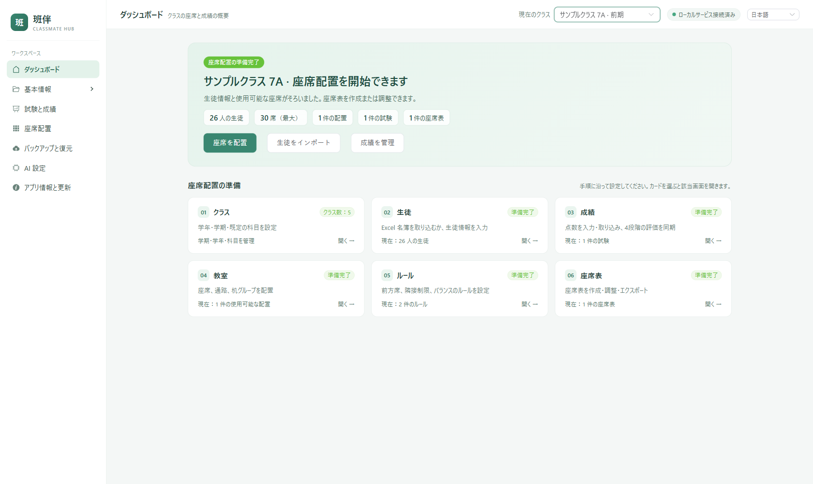
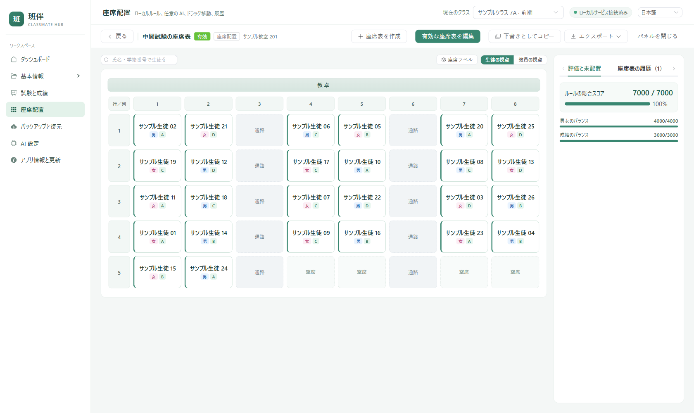
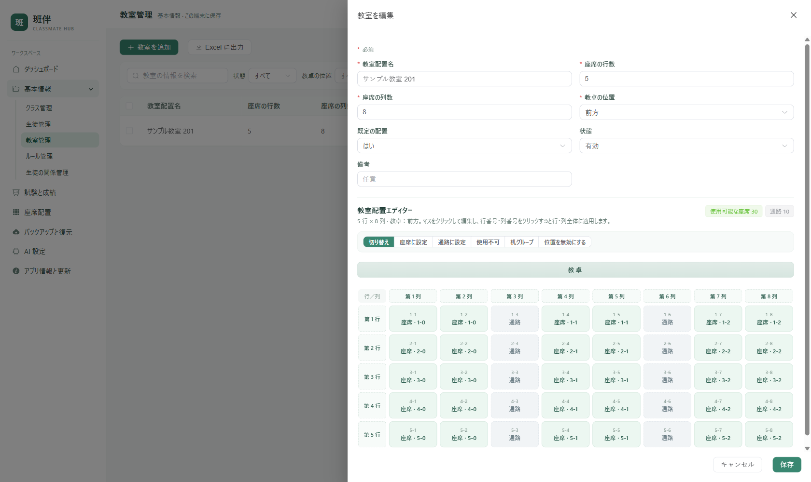
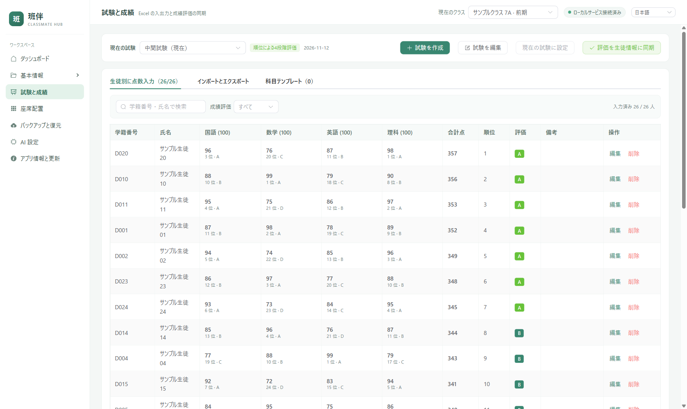
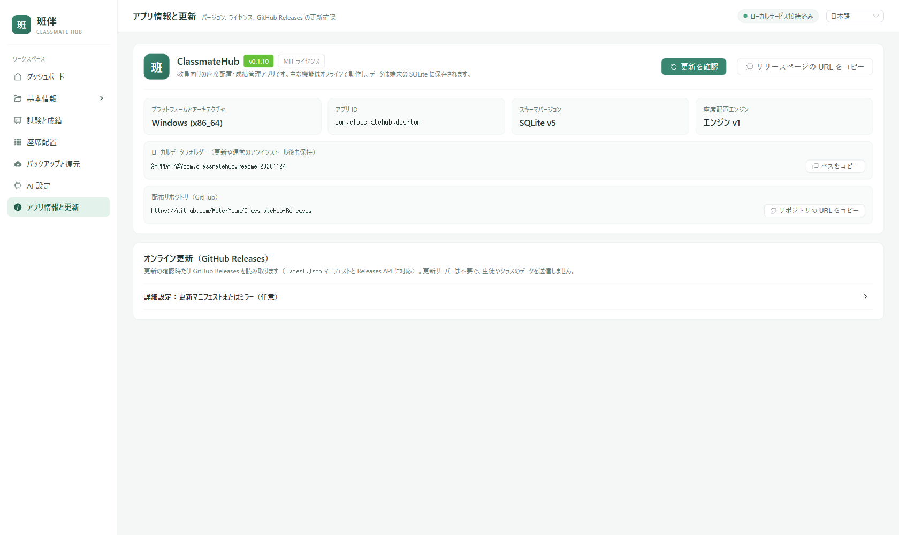

<div align="center">

# 班伴 ClassmateHub

**教員向けの座席配置・成績管理デスクトップアプリ**

サーバーの準備不要 · アカウント登録不要 · 主要機能はオフラインで利用可能 · Windows / macOS / Linux 対応

[](https://github.com/MeterYoug/ClassmateHub-Releases/releases/latest)
[](../project-overview.md)
[](#主な機能)
[](../../LICENSE)

[简体中文](../../README.md) · [English](README.en.md) · [繁體中文](README.zh-Hant.md) · **日本語** · [한국어](README.ko.md)

[ダウンロード](#ダウンロードと対応環境) · [画面プレビュー](#画面プレビュー) · [主な機能](#主な機能) · [使い方とアップグレード](#使い方とアップグレード) · [ローカル開発](#ローカル開発)

</div>

---

ClassmateHub は、既存の座席配置プロジェクトで使われていた教員の作業手順をもとに、単体で動作するデスクトップアプリとして開発されました。クラスと生徒の管理、成績の取り込みと分類、教室レイアウトの作成、自動座席配置、ドラッグ操作での調整、座席表の出力、データベース全体のバックアップと復元を一台の端末で行えます。インターネット接続が必要なのは、任意の AI 座席配置と手動での更新確認です。

## ダウンロードと対応環境

インストーラー、更新マニフェスト、チェックサムは、[最新の公開ベータ版](https://github.com/MeterYoug/ClassmateHub-Releases/releases/latest) から入手できます。

| 対応環境 | パッケージ形式 | ビルドと検証の状況 | 備考 |
| --- | --- | --- | --- |
| **Windows 11 x64** | NSIS インストーラー `.exe`、ポータブル版 `.zip` | 自動テスト、パッケージ作成、ZIP の展開を確認済み | インストーラーは WebView2 のオフラインインストーラーを同梱し、上書き更新に対応します。ポータブル版はシステムにインストール済みの WebView2 Runtime を使用します。 |
| **macOS（Apple Silicon）** | `.dmg`（macOS 15.0 以降） | GitHub Actions で自動テストとパッケージ作成に成功 | **実機でのインストール、動作、アップグレードは未検証です。** |
| **Ubuntu 24.04 LTS x64** | `.deb`（`classmatehub`） | GitHub Actions で自動テストとパッケージ作成に成功 | **実機でのインストール、動作、アップグレードは未検証です。** |

> [!NOTE]
> macOS と Linux の検証範囲は、現時点では GitHub Actions による自動テストとパッケージ作成です。Windows 11 x64 で上書き更新する場合は、アプリを終了してから新しいインストーラーを実行してください。ローカルデータは別の場所に保存され、上書き更新や通常のアンインストールでも保持されます。

## 画面プレビュー

> スクリーンショットは現在の開発プレビュー版の画面です。架空のサンプルデータを使用しています。

### 1. ダッシュボード

選択中のクラスの座席配置の準備状況、主要な件数、6 つの準備手順を確認できます。カードを選ぶと対応する機能を開きます。



### 2. 自動座席配置とリアルタイムのルール評価

独立した Rust のルールエンジンがオフラインで座席案を作成し、空席は既定で教卓から離れた右下を優先します。座席案の管理、座席ラベルの切り替え、ドラッグでの入れ替え、元に戻す・やり直す、座席の一括固定、履歴の比較、複数形式での出力に対応します。右側には各ソフト制約の得点がリアルタイムで表示されます。



### 3. 教室レイアウトエディター

教卓は教室の四辺のどこにでも設定できます。マスをクリックして、座席、通路、使用不可の位置、同じ机を使うグループを設定できます。行番号や列番号で一括編集でき、使用可能な座席数は随時更新されます。



### 4. 試験と成績の管理

クラスの既定科目の読み込み、科目テンプレートの編集、`.xlsx` の事前チェック、生徒ごとの連続入力に対応します。科目別と合計点の順位を計算し、A・B・C・D の 4 段階に分類します。評価を生徒情報に反映して座席配置のルールに使えます。



### 5. アプリ情報とオンライン更新

アプリ、SQLite、座席配置エンジンのバージョン、動作環境、ローカルデータの保存先を確認できます。手動で GitHub Releases に接続して新しいバージョンを確認・取得できます。任意の HTTPS 更新元を設定でき、更新確認で生徒や学校のデータは送信されません。



## 主な機能

| 機能 | 内容 |
| --- | --- |
| **ダッシュボードとナビゲーション** | 全ページで共通の上部バーからクラスを切り替えられます。クラス、名簿、成績、レイアウト、ルール、座席案の準備状況を確認し、各機能を開けます。 |
| **基本データと新学期への引き継ぎ** | 小学 1 年から高校 3 年までの学年に標準科目が連動します。絞り込み、入力検証、一括無効化、Excel 出力に対応します。新学期の年度と学期を自動で割り出し、生徒、関係、ルール、既定の教室レイアウトを必要に応じて引き継げます。 |
| **試験と成績の管理** | `.xlsx` テンプレートを取得でき、全行の事前チェックに合格した時点で保存します。空欄の科目は元の点数を保持し、`缺考` で欠席、`清空` で点数の消去を指定できます。新しい試験では総合順位から A〜D を割り当てて生徒情報に反映でき、以前の試験は得点率を引き続き使用できます。 |
| **教室レイアウトと座席配置ルール** | 教卓の 4 方向指定、グリッド描画、行や列の一括編集、座席の詳細設定に対応します。前列の指定、同じ机や隣席の禁止、同じ机への優先配置を設定できます。視力、身長、性別、成績、生活態度に関するハード制約とソフト制約も設定できます。 |
| **自動座席配置と複数形式の出力** | 乱数シードを固定して配置を再現でき、空席は既定で右下に残します。空の座席案からの手動作成、ドラッグでの移動・入れ替え、元に戻す・やり直す、一括固定、座席案の管理、同じクラスの旧案のアーカイブ、差分の比較に対応します。生徒用と教員用の PNG、Excel、A4 横向き PDF を出力できます。 |
| **データベースのバックアップとロールバック** | SQLite Online Backup API を使い、整合性のある `.classmatehub-backup` を出力します。上書き復元の前に読み取り専用の事前検証を行い、復元ポイントを作成します。検証に失敗した場合や復元が中断した場合は自動で元の状態に戻します。 |
| **任意の AI 座席配置と個人情報の保護** | プロバイダーのプリセット、モデル検索、接続テスト、既定モデルの設定に対応します。送信のたびに接続先、モデル、送信内容の確認が必要です。送信するのは一時 ID、座席の座標、ハード制約のみで、氏名、学籍番号、成績は端末内に保持されます。 |
| **アプリ情報と更新** | 手動操作時だけ `latest.json` または Releases API を使って `ClassmateHub-Releases` に読み取り専用の問い合わせを行います。HTTPS の更新マニフェスト URL を指定でき、アプリからインストーラーを保存できます。 |

## 使い方とアップグレード

<details>
<summary><strong>基本データ、Excel の取り込み、成績の扱い</strong></summary>

- **生徒の取り込み。** 生徒管理画面から取り込み用テンプレートを取得します。学籍番号、氏名、性別、身長、視力、生活態度、成績区分、配慮事項、表示順、備考を入力できます。同じクラスにいる生徒を学籍番号で更新する場合、任意項目の空欄は既存の値を保持します。
- **成績の取り込みと分類。** `.xlsx` を使用し、学籍番号のセルは文字列形式のままにします。合計点と順位はアプリが再計算します。点数の空欄は既存値を保持し、`缺考` で欠席、`清空` で点数の消去を指定できます。新しい試験はクラス内の総合順位で A〜D の 4 グループに均等に分けます。以前の試験は既定で得点率を使用し、試験の編集時に方式を切り替えられます。
- **順位と科目の列見出し。** 順位方式では、合計点に含まれる少なくとも 1 科目に数値がある場合に順位を計算します。入力された 0 点も有効です。科目名が `等级`（評価）や `总分`（合計点）などと重なる場合は、該当する試験のテンプレートを取得し、指定の科目列に入力してください。
- **ルールとデータ保護。** 教室を縮小する前に、座席の詳細設定で範囲外になる座席を無効にします。既存の独自ルールや無効な設定を持つルールは、設定を保持したまま停止できます。ページやクラスの切り替え、ウィンドウを閉じるときに未保存の変更を通知します。既存データの保存時には同時変更も検出します。

</details>

<details>
<summary><strong>座席配置、出力、バックアップ、AI 利用時のプライバシー</strong></summary>

- **座席配置とスナップショット。** 新しい座席案では同じ行で隣り合う座席を既定で組み合わせ、独自のグループ設定があれば優先します。保存時に名簿、レイアウト、ルールを記録するため、基本データを変更しても過去の案は変わりません。
- **座席表の視点と出力。** 教員視点では教卓と座席表が一緒に 180° 回転し、座席番号は教室レイアウト上の番号を保持します。PNG、Excel、PDF には選択中の視点を反映します。PNG と PDF は白地に黒枠で、モノクロ印刷に対応します。行番号は左、列番号は上、氏名は中央に表示し、ルールの得点は省略します。PDF は A4 横向きの 1 ページに全席を収めます。教員用 Excel には学籍番号、固定した席の目印、ルール評価用シートが含まれます。
- **バックアップと復元。** バックアップには生徒、成績、過去の座席案が含まれるため、適切に保管してください。システム認証情報とログは含まれません。他の端末で復元した後は AI 接続先と認証情報を再設定します。
- **AI 座席配置と代替処理。** Windows はシステムの資格情報ストアに AI のキーを保存します。接続試験は定型テキストだけを送信します。AI の座席案を保存するには端末内でハード制約の検証に合格する必要があります。失敗時は教員がローカル座席配置への切り替えを選択するまで待機し、切り替え時には同じスナップショット、固定席、乱数シードを使用します。

</details>

<details>
<summary><strong>Windows の上書き更新と 0.1.8 からの更新</strong></summary>

- **Windows の上書き更新。** 同じ Windows アカウントでアプリを終了し、新しい NSIS インストーラーを実行します。既定では上書き更新が選択され、ローカルデータと既存のインストール先を保持します。
- **オンライン更新の確認。** `0.1.9` 以降は、アプリ情報画面から更新を確認すると、既定で `ClassmateHub-Releases` の GitHub Releases に接続します。
- **`0.1.8` からの更新。** アプリ情報と更新の詳細設定に次の URL を入力して、更新を確認してください。
  ```text
  https://github.com/MeterYoug/ClassmateHub-Releases/releases/latest/download/latest.json
  ```

</details>

## ローカル開発

Node.js、npm、Rust ツールチェーンが必要です。Windows では Visual Studio C++ Build Tools と WebView2 Runtime も必要です。各環境のパッケージ作成に必要なものは [プロジェクト概要（簡体字中国語）](../project-overview.md) を参照してください。

```powershell
# フロントエンドの依存関係をインストール
npm ci

# デスクトップアプリを開発モードで起動（初回は Rust の依存関係をコンパイル）
npm run tauri dev

# フロントエンドのみをビルド（ブラウザー単体ではデスクトップコマンドを利用できません）
npm run build
```

## プロジェクト文書とライセンス

| 文書 | 内容 |
| --- | --- |
| [プロジェクト概要と技術設計（簡体字中国語）](../project-overview.md) | 対象範囲、データベース設計、座席配置エンジン、バックアップと復元、各環境でのビルド手順 |
| [MIT ライセンス](../../LICENSE) | 本プロジェクトのオープンソースライセンス |
