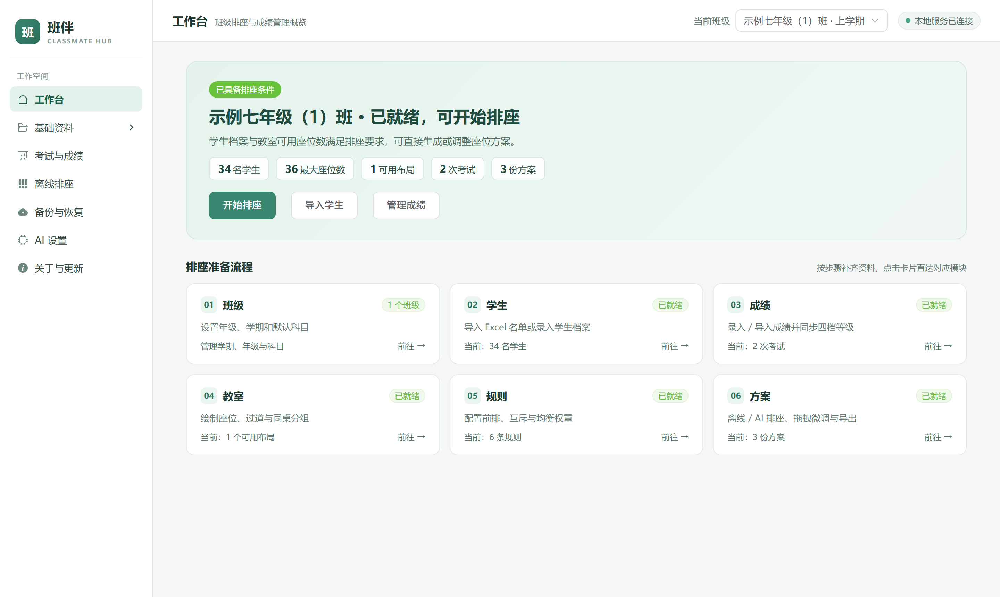
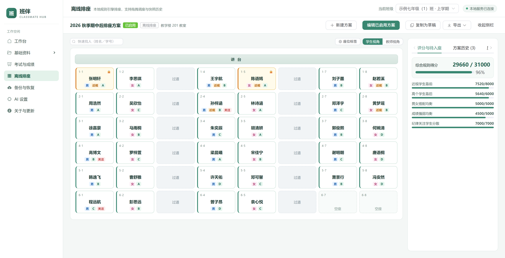
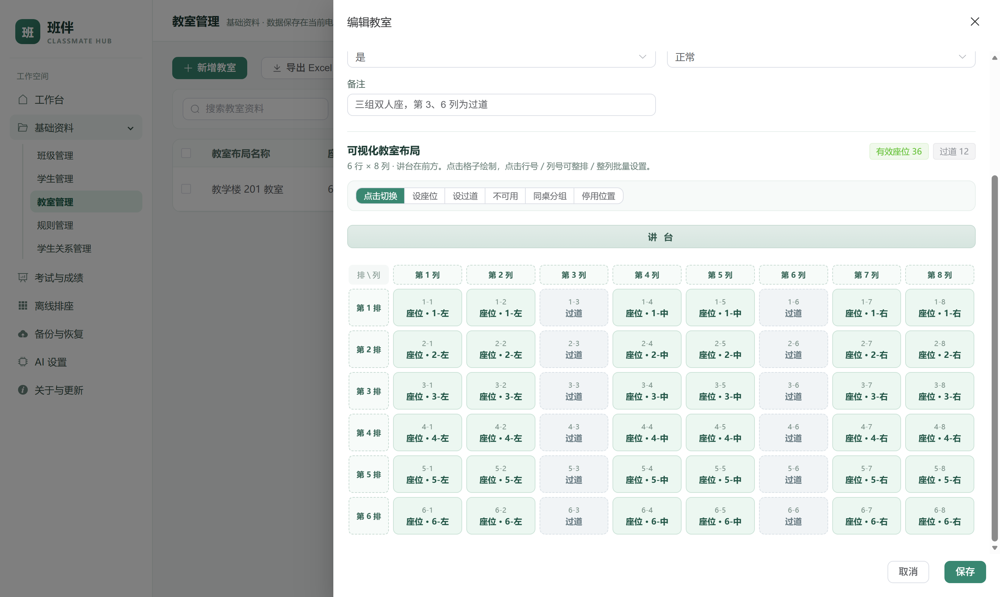
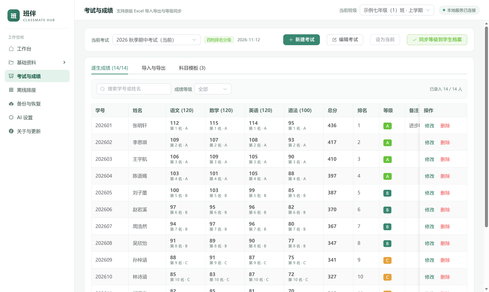
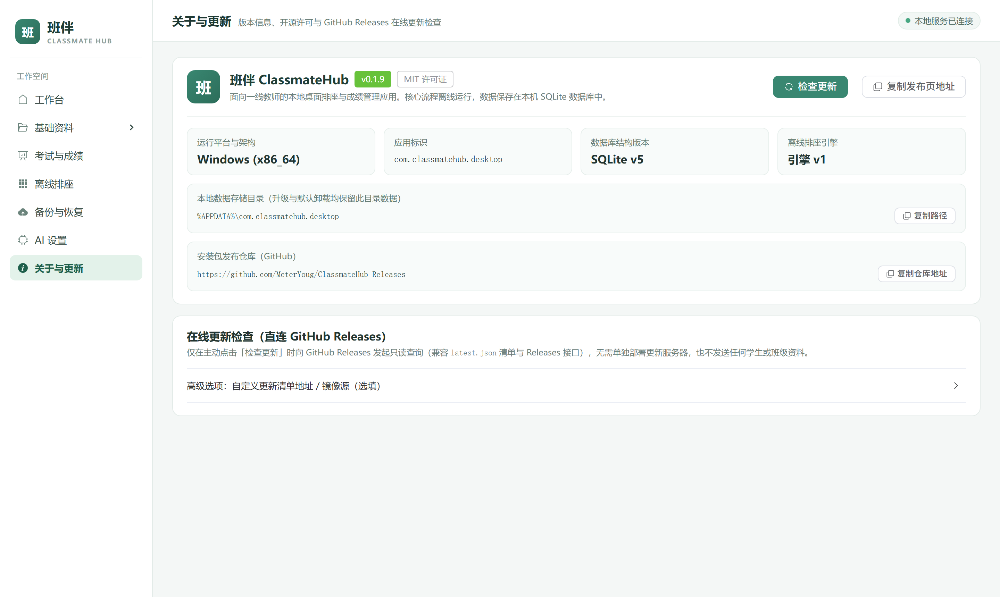

<div align="center">

# ClassmateHub 班伴

**교사를 위한 오프라인 교실 자리 배치 및 성적 관리 데스크톱 앱**

서버 설치 불필요 · 회원가입 불필요 · 주요 기능 오프라인 지원 · Windows / macOS / Linux 지원

[](https://github.com/MeterYoug/ClassmateHub-Releases/releases/latest)
[](../project-overview.md)
[](#주요-기능)
[](../../LICENSE)

[简体中文](../../README.md) · [English](README.en.md) · [繁體中文](README.zh-Hant.md) · [日本語](README.ja.md) · **한국어**

[다운로드](#다운로드-및-지원-환경) · [화면 미리 보기](#화면-미리-보기) · [주요 기능](#주요-기능) · [사용 및 업그레이드](#사용-및-업그레이드) · [로컬 개발](#로컬-개발)

</div>

---

ClassmateHub는 기존 교실 자리 배치 프로젝트의 교사 업무 흐름을 바탕으로 새로 개발한 독립형 데스크톱 앱입니다. 한 컴퓨터에서 학급과 학생 관리, 시험 성적 가져오기와 등급 분류, 교실 배치 그리기, 규칙에 따른 자동 자리 배치, 드래그로 자리 조정, 좌석표 내보내기, 전체 데이터베이스 백업 및 복원을 할 수 있습니다. 선택 기능인 AI 자리 배치와 수동 업데이트 확인에만 인터넷 연결이 필요합니다.

## 다운로드 및 지원 환경

[최신 공개 베타 릴리스](https://github.com/MeterYoug/ClassmateHub-Releases/releases/latest)에서 설치 파일, 업데이트 매니페스트, 체크섬 파일을 받을 수 있습니다.

| 플랫폼 | 패키지 형식 | 빌드 및 검증 상태 | 참고 |
| --- | --- | --- | --- |
| **Windows 11 x64** | NSIS 설치형 `.exe`, 무설치형 `.zip` | 자동 테스트, 패키징, ZIP 압축 해제 검증 완료 | 설치형에는 WebView2 오프라인 설치 프로그램이 포함되어 있으며 기존 설치를 업그레이드할 수 있습니다. 무설치형에는 시스템에 설치된 WebView2 Runtime이 필요합니다. |
| **macOS(Apple Silicon)** | `.dmg`(macOS 15.0 이상) | GitHub Actions에서 자동 테스트 및 패키징 완료 | **실제 기기에서 설치, 실행, 업그레이드를 아직 테스트하지 않았습니다.** |
| **Ubuntu 24.04 LTS x64** | `.deb`(`classmatehub`) | GitHub Actions에서 자동 테스트 및 패키징 완료 | **실제 기기에서 설치, 실행, 업그레이드를 아직 테스트하지 않았습니다.** |

> [!NOTE]
> macOS와 Linux는 현재 GitHub Actions의 자동 테스트와 패키징까지 검증했습니다. Windows 11 x64에서 업그레이드할 때는 ClassmateHub를 종료한 뒤 새 설치 프로그램을 실행하세요. 로컬 데이터는 별도로 저장되며 업그레이드 및 기본 제거 과정에서 보존됩니다.

## 화면 미리 보기

> 모든 화면의 학생 정보는 가상의 예시 데이터입니다.

### 1. 대시보드

현재 학급의 자리 배치 준비 상태, 주요 현황, 여섯 가지 준비 단계를 확인합니다. 카드를 선택하면 해당 기능이 열립니다.



### 2. 자동 자리 배치와 실시간 규칙 점수

독립적인 Rust 규칙 엔진이 오프라인에서 배치안을 생성합니다. 기본 설정에서는 교탁에서 멀리 떨어진 오른쪽 아래부터 빈자리를 둡니다. 배치안 관리, 좌석 라벨 전환, 드래그로 자리 교환, 실행 취소와 다시 실행, 일괄 좌석 고정, 이전 배치안 비교, 여러 형식으로 내보내기를 지원합니다. 오른쪽 패널에서 선호 조건별 점수를 실시간으로 확인할 수 있습니다.



### 3. 교실 배치 편집기

교탁은 교실의 네 방향 중 어느 쪽에도 놓을 수 있습니다. 격자 칸을 눌러 좌석, 통로, 사용 불가 위치를 그리고 짝 그룹을 지정합니다. 행이나 열 번호를 선택하면 한 번에 편집할 수 있고, 사용 가능한 좌석 수가 즉시 갱신됩니다.



### 4. 시험 및 성적 관리

학급 기본 과목 불러오기, 과목 템플릿 관리, `.xlsx` 가져오기 전 검증, 학생별 연속 입력을 지원합니다. 과목별 및 총점 순위를 계산해 A부터 D까지 네 등급을 부여합니다. 등급을 학생 정보에 반영하면 자리 배치 규칙에서 사용할 수 있습니다.



### 5. 앱 정보 및 온라인 업데이트

현재 앱 버전과 실행 환경, SQLite와 자리 배치 엔진의 버전, 로컬 데이터 저장 위치를 확인합니다. GitHub Releases에서 수동으로 업데이트를 확인하고 새 패키지를 받을 수 있습니다. HTTPS 업데이트 주소를 직접 지정할 수 있으며 업데이트 확인 시 학생 정보나 업무 데이터는 전송되지 않습니다.



## 주요 기능

| 모듈 | 기능 |
| --- | --- |
| **대시보드 및 메뉴 이동** | 모든 화면에서 공통 상단 메뉴로 현재 학급을 바꿀 수 있습니다. 학급, 명단, 성적, 교실 배치, 규칙, 배치안의 준비 진행률을 확인하고 각 화면으로 이동합니다. |
| **기초 자료와 새 학기 복사** | 초등학교 1학년부터 고등학교 3학년까지 지원하며 학년별 기본 과목을 연결합니다. 필터링, 입력 검증, 일괄 비활성화, Excel 내보내기를 지원합니다. 새 학기의 학년도와 학기를 자동으로 계산해 학생, 관계, 규칙 및 기본 교실 배치를 필요에 따라 복사합니다. |
| **시험 및 성적 관리** | `.xlsx` 템플릿을 내려받을 수 있으며 모든 행이 사전 검증을 통과하면 저장합니다. 점수 칸이 비어 있으면 이전 값을 유지하고, `缺考`로 결시를 표시하거나 `清空`으로 점수를 지웁니다. 새 시험의 총점 순위로 A~D 등급을 부여해 학생 정보에 반영할 수 있으며 기존 시험은 득점률 방식을 유지할 수 있습니다. |
| **교실 배치 및 규칙** | 교탁 위치 네 방향 지정, 격자 편집, 행과 열 일괄 수정, 고급 좌석 설정을 지원합니다. 앞자리 배정, 짝 또는 인접 자리 금지, 짝 우선 배정과 시력, 신장, 성별, 성적, 생활 태도에 관한 필수 조건과 선호 조건을 설정합니다. |
| **자동 자리 배치 및 내보내기** | 고정된 난수 시드로 같은 결과를 재현하며, 빈자리는 기본적으로 오른쪽 아래에 배치합니다. 빈 배치안에서 수동 편집, 드래그로 이동·교환, 실행 취소와 다시 실행, 일괄 고정, 배치안 관리, 같은 학급의 이전 배치안 보관, 변경 비교를 지원합니다. 학생용 또는 교사용 좌석표를 PNG, Excel, A4 가로 PDF로 내보냅니다. |
| **전체 백업과 중단 시 원상 복구** | SQLite Online Backup API로 일관성이 보장되는 `.classmatehub-backup` 파일을 내보냅니다. 덮어쓰기 복원 전에 읽기 전용으로 검증하고 복원 지점을 만듭니다. 검증 실패나 복원 중단 시 자동으로 이전 상태로 돌아갑니다. |
| **선택형 AI 자리 배치 및 비식별화** | 공급자 프리셋, 모델 검색, 연결 테스트, 기본 모델 설정을 지원합니다. 요청할 때마다 서비스 주소, 모델, 전송 내용을 확인합니다. 일회용 임시 ID, 좌석 좌표, 필수 조건만 보내며 이름, 학번, 성적은 기기에 남습니다. |
| **앱 정보 및 업데이트** | 사용자가 실행한 경우에만 `latest.json` 또는 Releases API를 통해 `ClassmateHub-Releases`를 읽기 전용으로 조회합니다. HTTPS 매니페스트 주소를 지정하고 앱에서 설치 프로그램을 저장할 수 있습니다. |

## 사용 및 업그레이드

<details>
<summary><strong>기초 자료, Excel 가져오기, 성적 기준</strong></summary>

- **학생 가져오기.** 학생 관리에서 가져오기 템플릿을 받습니다. 학번, 이름, 성별, 신장, 시력, 생활 태도, 성적 등급, 특별 배려 사항, 정렬 순서, 비고를 입력할 수 있습니다. 학번을 기준으로 현재 학급의 기존 학생을 업데이트할 때 비어 있는 선택 항목은 기존 값을 유지합니다.
- **성적 가져오기와 등급 분류.** `.xlsx` 파일을 사용하고 학번을 텍스트 형식으로 유지하세요. 앱이 총점과 순위를 다시 계산합니다. 점수 칸이 비어 있으면 기존 점수를 유지하며, `缺考`를 입력하면 결시, `清空`을 입력하면 점수 삭제로 처리됩니다. 새 시험은 학급 총점 순위에 따라 A~D 네 등급으로 균등하게 나뉩니다. 기존 시험은 기본적으로 득점률 방식을 유지하며 시험 편집에서 바꿀 수 있습니다.
- **순위와 과목 열 이름.** 순위 방식에서는 총점에 반영되는 과목 중 하나 이상에 숫자 점수가 있어야 순위에 포함됩니다. 실제 입력한 0점도 유효합니다. 과목명이 `等级`(등급), `总分`(총점) 같은 열 이름과 겹치면 해당 시험의 템플릿을 받고 지정된 과목 열에 입력하세요.
- **규칙과 보호 장치.** 교실 배치를 줄이기 전에 고급 좌석 설정에서 새 범위 밖에 있는 좌석을 비활성화하세요. 기존 사용자 정의 규칙이나 설정에 문제가 있는 규칙은 설정을 보존한 상태로 비활성화할 수 있습니다. 페이지나 학급을 바꾸거나 창을 닫을 때 저장되지 않은 변경 사항을 알리고, 기존 자료를 저장할 때 동시에 발생한 변경을 검사합니다.

</details>

<details>
<summary><strong>자리 배치, 내보내기, 백업, AI 개인정보 보호</strong></summary>

- **자리 배치와 스냅샷.** 새 배치안은 같은 행의 이웃 좌석을 기본적으로 짝으로 지정하며 사용자 정의 짝 그룹이 우선합니다. 저장 시 당시 명단, 교실 배치 및 규칙을 기록하므로 기초 자료를 바꾸어도 이전 배치안은 그대로 유지됩니다.
- **좌석표 보기와 내보내기.** 교사용 보기로 바꾸면 교탁과 좌석표가 함께 180° 회전하며 좌석 번호는 교실에 정해진 번호를 유지합니다. PNG, Excel, PDF에는 선택한 보기가 적용됩니다. PNG와 PDF는 흰 배경과 검은 테두리를 사용해 흑백 인쇄에 적합합니다. 행 번호는 왼쪽, 열 번호는 위쪽, 이름은 가운데에 표시하며 규칙 점수는 생략합니다. PDF는 좌석표 전체를 A4 가로 한 페이지에 맞춥니다. 교사용 Excel에는 학번, 고정 좌석 표시, 규칙 점수 시트가 포함됩니다.
- **백업 및 복원.** 백업에 학생, 성적, 이전 배치안이 포함되므로 안전하게 보관하세요. 시스템 자격 증명과 로그는 백업에 포함되지 않습니다. 다른 기기에서 복원한 후에는 AI 서비스 주소와 자격 증명을 다시 설정하세요.
- **AI 자리 배치와 로컬 대체.** Windows에서는 시스템 자격 증명 저장소에 AI 키를 저장하며 연결 테스트에는 정해진 문구만 전송합니다. AI 배치안은 로컬 필수 조건 검증을 통과해야 저장할 수 있습니다. 실패하면 교사가 로컬 자동 자리 배치를 선택할 때까지 기다리며, 로컬 배치에서는 같은 스냅샷, 고정 좌석, 난수 시드를 사용합니다.

</details>

<details>
<summary><strong>Windows 업그레이드 및 0.1.8에서 업데이트</strong></summary>

- **Windows 기존 설치 업그레이드.** 같은 Windows 계정에서 ClassmateHub를 종료하고 새 NSIS 설치 프로그램을 실행하세요. 기본 옵션은 로컬 데이터와 기존 설치 경로를 유지하는 업그레이드입니다.
- **온라인 업데이트 확인.** `0.1.9`부터 앱 정보에서 업데이트를 확인하면 기본적으로 `ClassmateHub-Releases`의 GitHub Releases에 연결합니다.
- **`0.1.8`에서 업데이트.** 앱 정보 및 업데이트의 고급 옵션에 다음 주소를 입력한 후 업데이트를 확인하세요.
  ```text
  https://github.com/MeterYoug/ClassmateHub-Releases/releases/latest/download/latest.json
  ```

</details>

## 로컬 개발

Node.js, npm, Rust 툴체인이 필요합니다. Windows에서는 Visual Studio C++ Build Tools와 WebView2 Runtime도 필요합니다. 플랫폼별 패키징 준비 사항은 [프로젝트 개요(중국어 간체)](../project-overview.md)를 참고하세요.

```powershell
# 프런트엔드 의존성 설치
npm ci

# 개발 모드에서 데스크톱 앱 실행(처음에는 Rust 의존성을 컴파일)
npm run tauri dev

# 프런트엔드만 빌드(브라우저에서는 데스크톱 명령을 실행할 수 없음)
npm run build
```

## 프로젝트 문서와 라이선스

| 문서 | 설명 |
| --- | --- |
| [프로젝트 개요 및 기술 설계(중국어 간체)](../project-overview.md) | 제품 범위, 데이터베이스 설계, 자리 배치 엔진, 백업 및 복원, 플랫폼별 패키징 |
| [MIT 라이선스](../../LICENSE) | 프로젝트 코드에 적용되는 오픈 소스 라이선스 |
