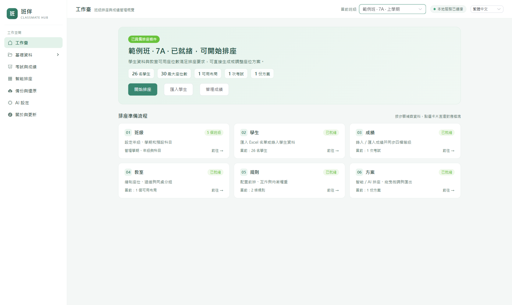
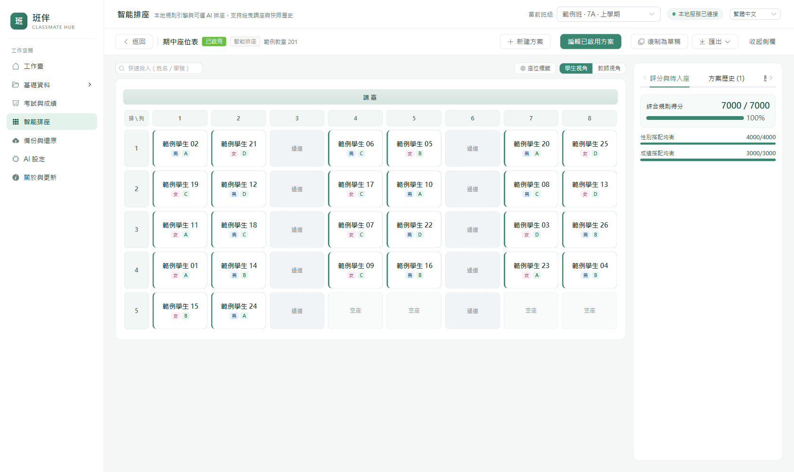
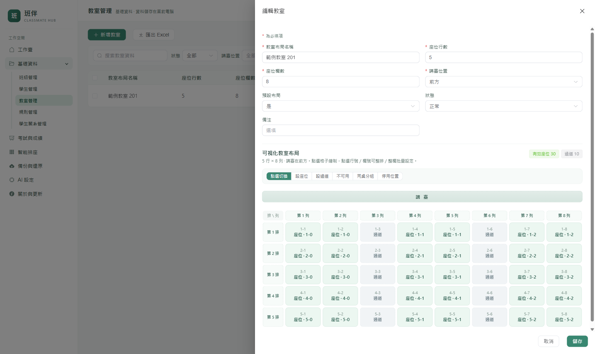
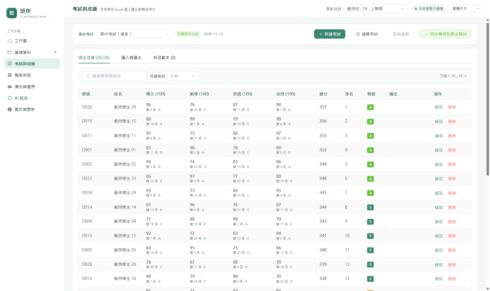
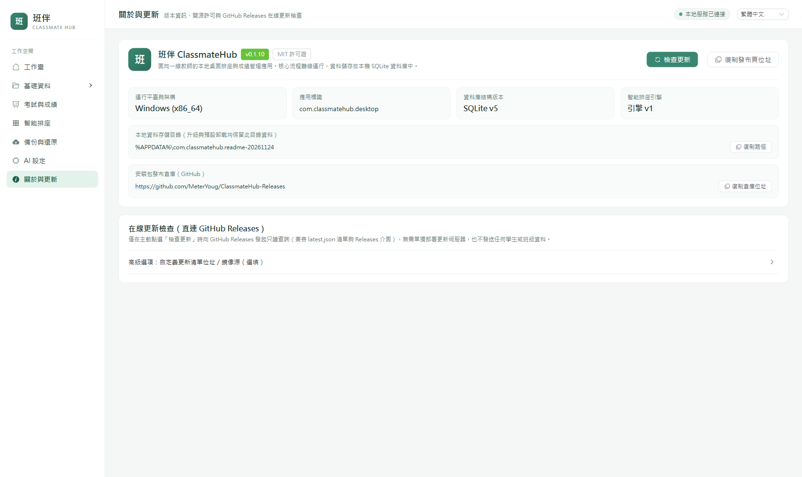

<div align="center">

# 班伴 ClassmateHub

**為第一線教師設計的桌面排座與成績管理工具**

無須架設伺服器 · 無須註冊或登入 · 核心功能可離線使用 · 支援 Windows / macOS / Linux

[](https://github.com/MeterYoug/ClassmateHub-Releases/releases/latest)
[](../project-overview.md)
[](#核心功能)
[](../../LICENSE)

[简体中文](../../README.md) · [English](README.en.md) · **繁體中文** · [日本語](README.ja.md) · [한국어](README.ko.md)

[下載](#下載與平台支援) · [介面預覽](#介面預覽) · [核心功能](#核心功能) · [使用與升級](#使用與升級) · [本機開發](#本機開發)

</div>

---

班伴以原排座專案的教師操作流程為參考，重新打造適合單機使用的桌面應用程式。教師可以在一台電腦上管理班級與學生、匯入考試成績並分級、繪製教室配置、依規則自動排座、拖曳微調、匯出座位表，以及備份或還原整個資料庫。選用 AI 排座或手動檢查更新時才需要連線。

## 下載與平台支援

請至 [最新公開測試版](https://github.com/MeterYoug/ClassmateHub-Releases/releases/latest) 下載安裝程式、更新清單與校驗檔。

| 平台 | 檔案格式 | 建置與驗證狀態 | 說明 |
| --- | --- | --- | --- |
| **Windows 10／11 x64** | NSIS 安裝版 `.exe`、免安裝版 `.zip` | 已通過自動化測試、打包及 ZIP 解壓縮驗證。Windows 10 實機驗證待完成 | 安裝版內含 WebView2 離線安裝程式，支援覆蓋升級。免安裝版使用系統既有的 WebView2 Runtime。 |
| **macOS（Apple Silicon）** | `.dmg`（macOS 15.0 以上） | 已通過 GitHub Actions 自動化測試及打包 | **尚未在實機測試安裝、執行與升級。** |
| **Ubuntu 24.04 LTS x64** | `.deb`（`classmatehub`） | 已通過 GitHub Actions 自動化測試及打包 | **尚未在實機測試安裝、執行與升級。** |

> [!NOTE]
> macOS 和 Linux 目前的驗證範圍為 GitHub Actions 自動化測試及打包。Windows 10／11 x64 覆蓋升級前，請先關閉班伴，再執行新版安裝程式。應用程式會另外儲存本機資料，覆蓋升級與預設解除安裝皆會保留資料。

## 介面預覽

> 以下截圖取自目前的開發預覽版，使用合成範例資料。

### 1. 工作台總覽

查看目前班級的排座準備情形、重要數據與六個準備步驟，點選卡片可直接開啟對應功能。



### 2. 智慧排座與即時規則評分

獨立的 Rust 規則引擎可離線產生方案，預設將空位優先留在遠離講台的右下角。支援管理方案、切換座位標籤、拖曳換座、復原與重做、批次鎖定座位、比對歷史方案，以及多種格式的匯出。右側會顯示各項軟性規則的即時得分。



### 3. 視覺化教室配置編輯

講台可設在教室任一側。點選格子可繪製座位、走道、不可用位置及設定同桌分組。點選排號或欄號可批次設定整排或整欄，並即時查看可用座位數。



### 4. 考試與成績管理

支援帶入班級預設科目、管理科目範本、預先檢查 `.xlsx` 匯入資料，以及逐一輸入學生成績。系統會計算單科排名與總分排名，將成績分為 A 至 D 四級，並可同步至學生資料供排座規則使用。



### 5. 關於與線上檢查更新

可查看目前版本、執行平台、SQLite 與排座引擎版本，以及本機資料路徑。手動檢查更新時可連線至 GitHub Releases 取得新版，也可自訂 HTTPS 更新來源。檢查更新時不會傳送學生或校務資料。



## 核心功能

| 模組 | 功能 |
| --- | --- |
| **工作台與導覽** | 各頁共用頂端的目前班級選擇器。可查看建班、名單、成績、配置、規則和方案的準備進度，並快速開啟相關功能。 |
| **基本資料與新學期複製** | 支援國小一年級至高中三年級，並可帶入預設科目。提供篩選、表單驗證、批次停用及 Excel 匯出。新學期作業會自動推算目標學年度與學期，可依需要複製學生、關係、規則及預設教室配置。 |
| **考試與成績管理** | 可下載 `.xlsx` 範本，所有匯入資料通過預檢才會寫入。科目欄位留空會保留原分數，並支援 `缺考`、`清空` 狀態。新考試可依總分排名分為 A 至 D 四級並同步學生資料，舊考試仍可沿用得分比例。 |
| **教室配置與排座規則** | 講台可設在任一側，支援格線繪製、整排或整欄批次編輯，以及進階座位明細。可設定前排需求、不可同桌或相鄰、優先同桌等條件，以及視力、身高、性別、成績與紀律的軟性和硬性規則。 |
| **智慧排座與匯出** | 以固定亂數種子重現排座結果，空位預設留在右下角，也可手動建立空白方案。支援拖曳移座或換座、復原與重做、批次鎖定座位、管理方案、封存同班舊方案及比對變更。學生版和教師版皆可匯出 PNG、Excel 或橫向 A4 PDF。 |
| **資料庫備份與復原** | 使用 SQLite Online Backup API 匯出一致的 `.classmatehub-backup` 檔案。覆蓋還原前會執行唯讀預檢並建立還原點。驗證失敗或還原中斷時會自動回復。 |
| **選用 AI 排座與去識別化** | 提供服務商預設值、查詢模型、連線測試及預設模型設定。每次請求都須確認服務網址、模型與傳送內容。僅傳送一次性編號、座位座標和硬性限制，姓名、學號與成績皆留在本機。 |
| **關於與更新** | 使用者主動檢查時，才透過 `latest.json` 或 Releases API 對 `ClassmateHub-Releases` 發出唯讀查詢。可自訂 HTTPS 清單網址，也可直接將安裝程式另存至本機。 |

## 使用與升級

<details>
<summary><strong>基本資料、Excel 匯入與成績分級</strong></summary>

- **匯入學生。** 從「學生管理 → 匯入學生」下載範本，欄位包含學號、姓名、性別、身高、視力、紀律、成績等級、特殊需求、排序編號及備註。勾選依學號更新目前班級既有學生時，留空的選填欄位會保留原值。
- **匯入成績與分級。** 請使用 `.xlsx` 並將學號保留為文字格式，應用程式會重新計算總分與排名。分數留空會保留原值。填入 `缺考` 可標記缺考，填入 `清空` 可清除分數。新考試依班級總分排名平均分為 A 至 D 四級。舊考試預設沿用得分比例，也可在編輯考試時切換。
- **排名與科目欄名。** 依排名分級時，至少要有一門計入總分的科目具備數值才會納入總排名，實際輸入的 0 分也有效。若科目名稱與 `等级` 或 `总分` 等欄名相同，請下載該場考試的範本，在指定科目欄輸入成績。
- **規則與保護措施。** 縮小教室配置前，請在進階座位明細停用超出範圍的位置。停用既有自訂或異常規則時可保留原設定。切換頁面或班級、關閉視窗時，會提醒尚未儲存的變更。儲存既有資料時會檢查是否有同時發生的變更。

</details>

<details>
<summary><strong>排座、匯出、備份與 AI 隱私</strong></summary>

- **排座與快照。** 新方案預設將同排相鄰座位配成同桌，並優先採用自訂分組。儲存方案時會保留當下的名單、配置與規則快照，日後修改基本資料也不影響歷史方案。
- **座位表視角與匯出。** 切換至教師視角時，講台與座位表會一併旋轉 180°，座位編號仍對應原教室配置。PNG、Excel 和 PDF 都沿用選取的視角。PNG 和 PDF 採白底黑框，適合黑白列印，排號在左側、欄號在上方、姓名置中，省略規則得分。PDF 會將完整座位表縮放至一張橫向 A4。Excel 教師版保留學號、鎖座標記與規則評分工作表。
- **備份與還原。** 備份包含學生、成績及歷史方案，請妥善保管。備份不包含系統認證資訊或記錄檔。還原至其他裝置後，請重新設定 AI 服務網址與認證資訊。
- **AI 排座與備援。** Windows 使用系統認證儲存區保管 AI 金鑰，連線測試只傳送固定文字。AI 方案必須通過本機硬性限制檢查才可儲存。失敗時會等待教師選擇改用本機智慧排座，並沿用同一份快照、鎖定座位及亂數種子。

</details>

<details>
<summary><strong>Windows 覆蓋升級與 0.1.8 版的更新方式</strong></summary>

- **Windows 覆蓋升級。** 在同一個 Windows 帳戶中先關閉班伴，再執行新版 NSIS 安裝程式。安裝精靈預設選取覆蓋升級，並保留本機資料及既有安裝目錄。
- **線上檢查更新。** 自 `0.1.9` 起，從關於與更新頁面檢查更新時，會預設連線至 `ClassmateHub-Releases` 的 GitHub Releases。
- **從 `0.1.8` 更新。** 請在「關於與更新 → 進階選項」填入以下網址，再檢查更新。
  ```text
  https://github.com/MeterYoug/ClassmateHub-Releases/releases/latest/download/latest.json
  ```

</details>

## 本機開發

需要 Node.js、npm 及 Rust 工具鏈。Windows 還需要 Visual Studio C++ Build Tools 和 WebView2 Runtime。各平台打包所需工具請參閱 [專案總覽（簡體中文）](../project-overview.md)。

```powershell
# 安裝前端相依套件
npm ci

# 啟動桌面開發模式（第一次執行時會編譯 Rust 相依套件）
npm run tauri dev

# 只建置前端資源（獨立瀏覽器無法執行桌面命令）
npm run build
```

## 專案文件與授權

| 文件 | 說明 |
| --- | --- |
| [專案總覽與技術設計（簡體中文）](../project-overview.md) | 產品範圍、資料表設計、排座引擎、備份、還原及三個平台的建置說明 |
| [MIT 授權條款](../../LICENSE) | 本專案程式碼的開放原始碼授權 |
